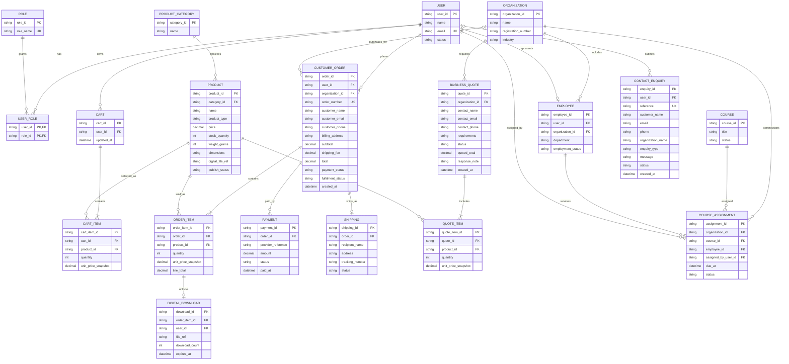

# Member 3 ERD Draft

This draft covers commerce and employer features owned by Member 3. It is a planning artifact for the Flutter prototype; the current implementation saves prototype records locally with shared_preferences and does not connect to Firebase or another backend. The ERD describes a proposed relational backend, not an existing database.

## Relationship notes

- `USER_ROLE` supports multiple roles per account. Authorization must be enforced by the backend, not only by hiding screens.
- `EMPLOYEE` connects an authenticated user to an organization. An invite may exist before the user finishes registration, so production design may need a separate invitation record.
- `CART_ITEM` stores a unit-price snapshot only if the product price at add-to-cart time must be retained; checkout should still confirm the current price.
- `CUSTOMER_ORDER` has many `ORDER_ITEM` rows and payment attempts. Physical items may have one shipping record; digital entitlements are tied to purchased order items.
- A `BUSINESS_QUOTE` belongs to an organisation and contains one or more `QUOTE_ITEM` rows. It is a pricing enquiry, not an order/payment. A customer-accepted quote can be converted into an order by a future backend workflow.
- `COURSE_ASSIGNMENT` records one employee receiving one course, with the assigning employer user and due date. Add a separate assignment batch entity if one action must group many employees.
- The current prototype records an assignment per selected employee. Production should add invitation/notification records and connect each employee to a real user account.
- Keep shipping details separate from billing details, and store the payment provider reference and validated status in the server-side payment record.
- `CONTACT_ENQUIRY` captures public website enquiries and may be submitted before the visitor creates an account, so `user_id` is optional. The admin inbox should retain status and response/audit details in the production backend.
- Store amounts in a fixed precision decimal type and store timestamps in UTC in the backend.

## Integrated prototype mapping

Employer email is the local organization discriminator on employees and assignments. Employee email links an assignment to a learner account. Course titles map to IDs in `lib/data/mock_data.dart`; a backend should replace this with immutable course and organization IDs. Local progress is keyed by learner email and course ID. Orders preserve product/price snapshots and stock-reservation state. A production backend must enforce these relationships, role permissions, entitlements and transactions independently of the Flutter client.
